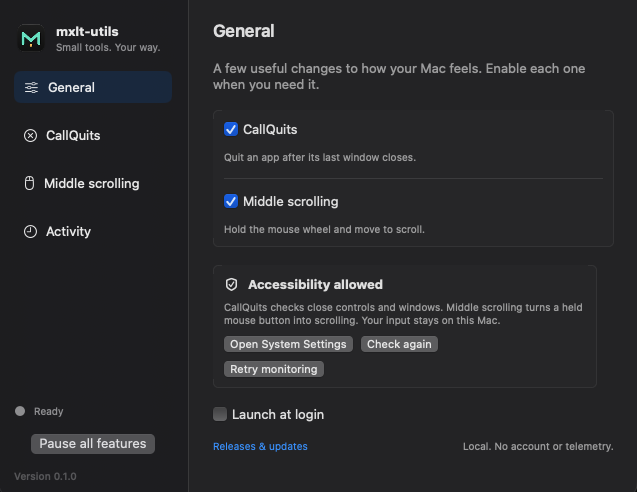

<p align="center">
  
</p>

<h1 align="center">mxlt-utils</h1>

<p align="center"><strong>Small tools. Your way.</strong></p>
<p align="center">A growing collection of small, native utilities for your Mac.<br>Built by <a href="https://github.com/Mxlted">Mxlted</a>.</p>

<p align="center">
  <a href="https://github.com/Mxlted/mxlt-utils/releases"></a>
  
  
  <a href="https://github.com/Mxlted/mxlt-utils/actions/workflows/ci.yml"></a>
  <a href="LICENSE"></a>
</p>

<p align="center">
  <a href="https://github.com/Mxlted/mxlt-utils/releases/download/v0.3.5/mxlt-utils-0.3.5-macos-arm64.dmg"><strong>Download for Mac</strong></a> ·
  <a href="#features">Features</a> ·
  <a href="#getting-started">Getting started</a> ·
  <a href="https://github.com/Mxlted/mxlt-utils/releases">Release notes</a> ·
  <a href="https://github.com/Mxlted/mxlt-utils/issues/new/choose">Report an issue</a>
</p>

<p align="center">
  
</p>

*Settings shown in an earlier preview; the current release includes the Fold icon.*

mxlt-utils brings everyday Mac conveniences together in one menu bar app. It grows as new needs come up, with each utility kept focused, optional, and easy to configure.

## Features

The descriptions below reflect the current source. The Quit on Close name, dialog Cancel handling, and middle-click tab quitting are unreleased; the download above is v0.3.5.

Available features:

### Close the window. Quit the app.

**Quit on Close** quits an app after you close its last window, so finished apps don't linger in the Dock. Use the red close button, or enable support for **⌘W** and supported native tab closing, including middle-clicking a tab.

- **Keep the apps you need.** Choose exceptions for music, messaging, terminals, and anything else you want running.
- **Respect unfinished work.** Save prompts, canceled closes, and replacement windows prevent automatic quitting. If window state is unclear, the app stays open.
- **Choose your close behavior.** Last-window quitting is the default. An optional setting lets the red button quit after closing any window.

### Hold. Move. Scroll.

**Middle scrolling** turns a held mouse wheel into continuous scrolling. Move away from where you pressed to scroll vertically, horizontally, or diagonally. Move farther to go faster.

- **Stop naturally.** Return to the center to pause; release the button or press Escape to finish.
- **Make it comfortable.** Smooth scrolling eases speed changes while keeping stops immediate. Adjust scroll speed up to 10×, the center dead zone, and scroll direction, or turn smoothing off for a direct response.
- **Keep familiar controls.** Short middle clicks are preserved when the original target is still available. Normal wheel and trackpad scrolling stay unchanged.
- **Choose where it works.** Exclude apps that use middle-drag for their own tools. Blender is excluded by default.

### Only what you enable

Each feature has its own switch. Enable just the tools you need, pause everything from the menu bar, and optionally launch at login. Turning a feature off stops its monitoring and keeps your settings for next time.

## Getting started

**Requires macOS 14 Sonoma or later and an Apple silicon Mac.** A mouse with a clickable wheel or middle button is needed for middle scrolling.

1. [Download the DMG](https://github.com/Mxlted/mxlt-utils/releases/download/v0.3.5/mxlt-utils-0.3.5-macos-arm64.dmg).
2. Open it and drag **mxlt-utils** into **Applications**.
3. Launch **mxlt-utils** and turn on the features you want. Features start off.
4. When prompted, allow **mxlt-utils** in **System Settings → Privacy & Security → Accessibility**, then return to the app and click **Check again**.

The app and DMG are Developer ID signed and notarized. Download checksums are included with each release.

> [!NOTE]
> **v0.3.5 is a preview release.** App compatibility and hardware coverage are still growing. See [tested environments and known limits](docs/TESTING.md#compatibility-evidence) before relying on a particular setup. Updates are downloaded manually from [Releases](https://github.com/Mxlted/mxlt-utils/releases).

## Privacy & permissions

**No account. No telemetry. No application network requests.** Everything the app does stays on your Mac. Opening the Releases link launches your browser only when you click it.

Accessibility lets Quit on Close check close buttons and windows, and lets middle scrolling respond to the held mouse button. Access is requested when a feature needs it. The Activity view keeps a small, temporary history of status changes; it does not record document names, document contents, keystrokes, or raw input.

## Questions & troubleshooting

<details>
<summary><strong>A feature isn't working. What should I check?</strong></summary>

Check that the feature is enabled, **Pause all features** is off, and Accessibility access is allowed. Click **Check again** after granting access. If access is allowed but monitoring hasn't started, click **Retry monitoring**.

After replacing a development build, you may need to remove the old Accessibility entry, add the copy in Applications, and relaunch. **Quit mxlt-utils before removing or replacing its Accessibility entry.** Avoid running another quit monitor alongside Quit on Close or another scroll remapper while troubleshooting middle scrolling.

</details>

<details>
<summary><strong>Mouse input became erratic after removing Accessibility access.</strong></summary>

Quit mxlt-utils to release its input monitoring. If its menu is inaccessible, use Activity Monitor to quit it, or Force Quit it if needed. If the keyboard still works, you can open Terminal and run `pkill -x MxltUtils` to stop the utility. Restore Accessibility access before reopening it if you want to use its features.

Version 0.3.5 checks whether input access still works when an enabled Accessibility entry is deleted; macOS can continue reporting it as allowed. It detaches monitoring when that check fails. Restore access, then click **Retry monitoring**. If you are using an older version, update to receive this fix.

</details>

<details>
<summary><strong>How do I keep a particular app running or preserve its middle-drag controls?</strong></summary>

Add it under **Quit on Close → Keep these apps running** or **Middle scrolling → Leave middle-drag unchanged**. Music, Spotify, Mail, Messages, FaceTime, Terminal, and iTerm start as editable quit exceptions. Finder, system processes, and mxlt-utils are always protected.

</details>

<details>
<summary><strong>What should I know about close behavior?</strong></summary>

Quit on Close requires a supported, verified close action. It never quits an app just because no windows are visible. Minimized windows and windows on other Spaces count when macOS makes them available to Accessibility; unreadable state prevents quitting. Apps with unusual window controls may not support every close method.

**⌘W, tab-close buttons, and middle-clicking a supported tab always require the last window to close and request a normal quit.** A remaining tab or window keeps the app running. Discord has a narrowly scoped exception for its verified hide-on-close behavior.

Clicking the verified Cancel button in an app’s only standalone dialog, including supported opening file choosers in TextEdit, Preview, and QuickTime Player, also requests a normal quit after the dialog disappears. Existing document windows, save sheets, replacement windows, and unreadable state prevent this. Simply launching an app with no windows never triggers quit.

Shift-click force quit is a separate, optional setting, off by default. It applies only to the red close button and can discard unsaved work.

</details>

<details>
<summary><strong>How do middle clicks and scrolling behave?</strong></summary>

Scrolling stays with the app, window, and starting point where you pressed, including the scrollable area under that point. Moving across windows doesn't redirect it. If the original target moves, becomes covered or hidden, closes, or can no longer be verified, the gesture is canceled.

A short, stationary press of up to half a second is delivered as a paired middle click only when the original target can still be verified. Longer stationary holds and canceled gestures do not produce clicks. Some apps limit scrolling to one axis. Secure input, remote desktops, and other input tools can affect compatibility.

Physical mouse, multi-display, and wider app coverage remain preview limitations. See the [testing guide](docs/TESTING.md) for exactly what has been checked.

</details>

<details>
<summary><strong>Can I use this alongside standalone CallQuits?</strong></summary>

Yes, if you use only middle scrolling in mxlt-utils. Run only one quit-on-close monitor at a time. Each app has its own preferences, Accessibility permission, and launch-at-login setting; nothing is migrated automatically.

</details>

## Build & contribute

Built with **Swift, SwiftUI, and AppKit**, with no third-party runtime dependencies. Use **Xcode 16.4 or newer**; open `Package.swift` to work in Xcode.

```sh
git clone https://github.com/Mxlted/mxlt-utils.git
cd mxlt-utils
swift test
./scripts/build.sh
open build/mxlt-utils.app
```

The build script creates a locally signed development app. For the notarized download, use [Releases](https://github.com/Mxlted/mxlt-utils/releases).

Have an everyday Mac task that could use a small utility? [Suggest it](https://github.com/Mxlted/mxlt-utils/issues/new/choose). New tools will be added as practical needs arise. Bug reports, focused improvements, and documentation fixes are welcome. Start with the [contributing guide](CONTRIBUTING.md).

| Guide | What you'll find |
| --- | --- |
| [Development](docs/DEVELOPMENT.md) | Toolchain, local builds, and project workflow |
| [Architecture](docs/ARCHITECTURE.md) | App structure, native services, and shared policies |
| [Testing](docs/TESTING.md) | Automated checks, native fixtures, and compatibility evidence |
| [Scrolling](docs/SCROLLING.md) | Gesture behavior and input handling |
| [Releasing](docs/RELEASING.md) | Signing, notarization, and packaging |

## License

[MIT](LICENSE) © 2026 Mxlted and contributors. CallQuits components are adapted from [CallQuits](https://github.com/Mxlted/CallQuits), with their copyright and permission notice retained. See [source provenance](docs/PROVENANCE.md) for implementation history.
